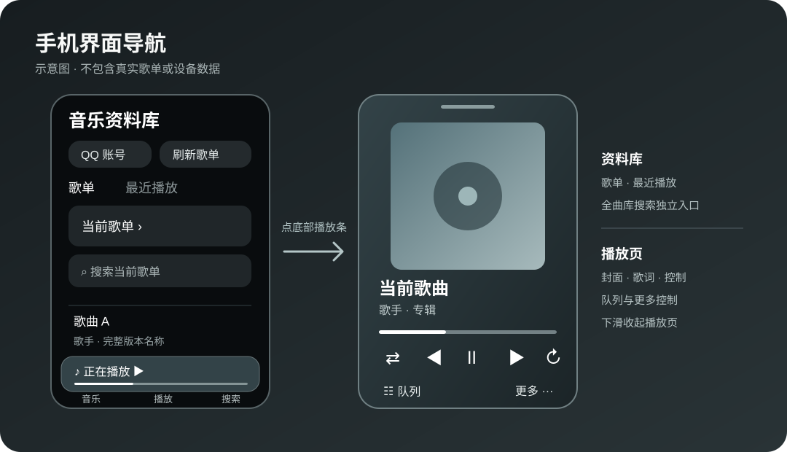

# Sonos QQ 音乐控制台

在 macOS 或 Linux 上运行的本地网页控制台。它通过 Sonos 的局域网接口读取播放状态、控制播放，并读取 QQ 音乐账号的自建歌单、收藏歌单及“我喜欢”。




> 上图是功能布局示意，不包含真实账号、歌单或设备信息。

**快速开始：**安装 Node.js 20+（推荐当前 LTS），确认运行设备与 Sonos 在同一局域网，在 Sonos App 中添加 QQ 音乐服务，然后按下文的[本地运行](#本地运行)启动服务；Linux NAS 可参照 [NAS / Linux 部署](#nas--linux-部署)。首次打开网页后，从“QQ 账号”登录，再选择歌单点播。

## 功能

- 播放、暂停、上一首、下一首、网页歌单随机播放、单曲循环、整队循环、淡入淡出、静音和音量控制；循环模式可与随机播放组合
- 播放进度每秒更新，并定期向 Sonos 校准；可拖动进度，拖动音量时即时同步到 Sonos
- 播放、暂停、切歌、歌单点播和队列点播采用统一状态同步：界面先即时反馈，再等待 Sonos 连续稳定回报，避免过渡状态显示为暂停或 0:00
- 查看 Sonos 当前播放队列，按正在播放的位置定位、翻页、点播，以及逐首上移、下移或移除
- 歌单及搜索结果可将歌曲设为下一首，或加入队列末尾
- 自动发现局域网 Sonos，无需固定音箱 IP；选择房间、重新发现音箱、组合或拆分房间，调节单个房间及分组音量
- 睡眠定时：设置多少分钟后停止，或在指定时间停止；定时保存在 Sonos 中，关闭网页后仍然有效
- QQ 音乐“我喜欢”、自建与收藏歌单：切换歌单、在歌单内直接搜索、整行点播、向下滚动自动加载更多；可用“定位正在播放”跳到当前歌曲。独立的全曲库搜索可逐页加载更多结果，点播后保持搜索面板打开
- 首次点击歌单歌曲会替换 Sonos 当前队列：先将所选歌曲加入队列并确认播放，再移除旧曲目，然后在后台按歌单顺序补齐其余曲目。若新歌未能播放，原队列会保留。再次点播已入队的歌曲直接切换；尚未入队的歌曲优先播放并重新补齐队列。正常导入时不显示进度消息，失败时提示原因。全曲库搜索结果按单曲点播处理
- 可添加多个 QQ 音乐网页登录状态，并从主页的“QQ 账号”二级菜单切换；网页登录用于显示歌单，音箱播放使用 Sonos 中配置的 QQ 音乐账号
- 在“当前歌单”卡片中打开可搜索的歌单列表；每个 QQ 账号会记住自己上次选中的歌单，重新打开网页或重启服务后继续显示该歌单
- 同一浏览器再次打开网页时先显示上次保存的歌单，再后台更新。缓存按 QQ 账号和歌单隔离；后台更新内容未变化时保留列表位置，更新失败时仍可查看缓存。首次访问或清除浏览器数据后需要重新加载
- “最近播放”记录通过本网页从歌单或全曲库成功发起的点播，每个网页 QQ 账号最多保留 100 首；可再次点播或清空。记录仅保存在本机，不会读取 QQ 音乐 App 或 Sonos App 的历史
- 专辑封面、逐行歌词和歌词面板；从 QQ 音乐播放歌词接口请求逐行翻译，原文与译文同步显示，没有译文时只显示原文。Sonos 队列缺少歌曲信息时，用 QQ 歌单补全标题、歌手、时长与封面
- 电脑端滚过主播放器后显示顶部控制工具栏；手机端底部导航只保留“音乐”和“搜索”，从音乐页的精简播放条进入完整播放页，向下滑动返回。精简播放条显示歌曲播放进度，音量在完整播放页中调节
- QQ 音乐扫码登录；登录过期时可重新登录或导入本机浏览器 Cookie
- macOS `launchd` 开机后自动运行的配置模板；Linux 可直接运行 Node.js，兼容 Docker 的 NAS 可用 Compose 部署

## 最近更新

### 歌单缓存与局域网自动发现

- 浏览器先恢复上次歌单，再确认当前 QQ 账号与所选歌单，并在后台更新；确认前缓存歌曲暂不可点播，避免用旧账号或旧歌单发起操作
- 缓存按账号与歌单隔离，内容未变化时保留列表和滚动位置；后台失败保留已有列表，切换期间的旧响应不再覆盖新歌单
- 歌单目录和歌曲列表并行加载，服务端合并相同账号、相同歌单的并发请求，减少重复拉取
- 无需设置 `SONOS_IP` 即可发现局域网音箱；增加“重新发现音箱”入口，保留固定 IP 作为可选的初始地址
- 设备地址失效后自动重新发现；用设备 ID 识别音箱，从拓扑中展示同一 Sonos 系统的可控制房间，隐藏配对成员不单独列出
- macOS 启动模板和 NAS Compose 默认使用自动发现；修复状态接口仍引用固定 IP 的问题
- 新增 20 项缓存与发现回归测试，覆盖存储异常、账号隔离、并发加载、设备地址恢复及多房间拓扑

### 其他已实现功能

- 全曲库搜索支持逐页加载更多；当前歌单可定位正在播放歌曲，减少常规成功提示，并补充手机文字放大与屏幕阅读器语义
- 增加 Linux/NAS 的原生 Node 与 Docker Compose 部署方式；`SONOS_DATA_DIR` 可将登录会话和播放记录持久化到代码目录以外
- 手机底部导航精简为“音乐 / 搜索”；点击精简播放条进入完整播放页。歌词页支持原文与 QQ 音乐逐行译文同步显示，例如 QQ 音乐提供翻译的英文歌曲
- 播放器改为从封面提取主色并应用到全页渐变；补全封面与逐行歌词展示
- 重新设计桌面与移动端播放控制，使用一致的图标、按压反馈和焦点处理；修复 iOS Safari 的残留高亮
- 将播放队列、睡眠定时、整队循环、淡入淡出和房间分组加入界面；不常用控制收进“更多控制”菜单
- 搜索、歌词、队列和操作菜单均支持点击遮罩关闭，并适配 iPhone Safari 的可视区域和底部安全区域
- 歌单支持自动加载更多、悬浮搜索和回到顶部；队列支持分页、点播和逐首调整
- 服务端增加队列、睡眠定时、房间拓扑和播放模式接口，并在 Sonos 缺少元数据时补全 QQ 音乐的歌曲信息
- 统一播放状态同步，覆盖播放、暂停、切歌、歌单点播、队列点播和进度拖动，避免 Sonos 过渡状态造成图标或进度滞后
- 暂停时切换上一首或下一首会直接开始播放；网页书签与页眉使用黑底白字图标
- 资料库改为“歌单 / 最近播放”两个页面内入口，手机上收紧封面区域，让歌曲列表更容易到达
- 手机界面按 Sonos App 的信息层级重排：资料库先显示，完整播放页一屏容纳常用控制，全曲库搜索独立成页，曲目操作从底部展开；歌单与搜索结果显示可用的专辑封面
- 手机可从底部精简播放条上滑打开完整播放页，从播放页向下滑动收起；播放页跟随手指移动，并为弹窗、列表切换及专辑配色变化加入过渡，系统选择“减少动态效果”时停用动画
- 歌词页使用封面色背景和逐行渐隐效果；手机上的队列、更多控制、账号、歌单、定时、房间和曲目操作统一为可下滑关闭的底部面板，关闭按钮与安全区间距保持一致
- 歌单后台导入改为静默执行；只有导入失败时才弹出一次错误提示，减少资料库页面的提示噪声
- 使用 QQ 音乐返回的完整标题，区分“十面埋伏”与“十面埋伏 (Live)”等不同版本
- 同一歌单重复点播时复用已入队歌曲；后台导入中选择未入队歌曲，会中止旧任务并优先播放新歌
- 队列点播与右侧“···”操作都会核对曲目身份，防止列表过期时误操作其他歌曲；这些操作与随机重排、循环模式切换按音箱串行执行，避免核对后队列又被网页上的另一操作改动。服务重启后会核对音箱上的完整队列，内容吻合时沿用已有歌单队列。队列版本变化时重新核对整队，日常点播只做轻量检查
- 播放、暂停、切歌和拖动进度条会立即更新界面，再核对 Sonos 返回的曲目、播放状态与进度；连续快速操作时，较早的响应不会覆盖后一次操作。页面从后台回到前台会立即刷新状态

## 要求

- macOS 或 Linux（包括支持 Docker 的 NAS）
- Node.js 20 或更高版本
- 运行服务的设备与 Sonos 位于可互相访问的局域网；服务端要能访问音箱的 TCP 1400 端口，并能访问 QQ 音乐服务
- Sonos 中已添加可播放的 QQ 音乐账号；首次使用前，Sonos 收藏或播放队列中需有一项 QQ 音乐内容，供本地服务识别 Sonos 的账号参数

## 本地运行

服务会自动发现同一局域网中的 Sonos，无需填写音箱 IP。在终端执行：

```sh
git clone git@github.com:knightyui/SonosWebControl.git
cd SonosWebControl/web
npm start
```

如果尚未配置 GitHub SSH，也可以用 `git clone https://github.com/knightyui/SonosWebControl.git`。项目没有第三方 npm 依赖，`npm start` 会直接调用已安装的 Node.js。保持终端打开，按 `Control-C` 可停止前台服务。

默认端口是 `38473`。浏览器打开：

```text
http://localhost:38473
```

需要换端口时，在启动命令中设置 `PORT`：

```sh
PORT=38473 npm start
```

同一局域网的设备可使用运行服务的设备的局域网地址访问该端口。请只在可信局域网中使用，不要将此服务暴露到公网。

### 自动发现与固定 IP

服务会扫描本机可用的 IPv4 网卡，验证发现设备的 Sonos 身份，再读取房间拓扑；首次发现需要短暂等待。之后复用已发现的设备地址，不会为每次播放控制都重新扫描。并发发现请求共用一次扫描，未找到音箱时会限制自动重试频率；手动“重新发现音箱”可主动再试。

运行服务的设备需与 Sonos 位于同一可发现的局域网。自动发现使用 UDP 1900 多播及音箱返回的 UDP 单播，设备控制使用 TCP 1400；VPN、VLAN、防火墙或容器桥接可能阻断发现。Linux Docker 请使用仓库提供的 `network_mode: host`。服务可在没有音箱时启动网页；连入音箱所在网络后，打开“更多控制 → 房间与分组 → 重新发现音箱”。

如果网络无法传递多播，可用 `SONOS_IP=192.168.x.x npm start` 指定初始音箱；此配置仍兼容旧部署，地址不可用时会尝试自动发现。Compose 可在未提交的 `.env` 中添加 `SONOS_IP=192.168.x.x`；macOS 的 plist 可在 `EnvironmentVariables` 中添加该变量。地址是可选项，不要把真实地址提交到仓库。自动发现只能发现服务所在局域网的音箱，不能跨互联网发现另一个家的设备。

### 环境变量

| 变量 | 默认值 | 用途 |
| --- | --- | --- |
| `SONOS_IP` | 空，自动发现 | 可选的音箱 IPv4 初始地址；不是网页服务器地址 |
| `PORT` | `38473` | 网页服务端口 |
| `HOST` | `0.0.0.0` | 网页监听地址；仅本机使用可设为 `127.0.0.1` |
| `SONOS_DATA_DIR` | 仓库的 `web/` | 登录会话与本机播放记录目录；Compose 默认为容器内 `/data` |

更改环境变量后需重启服务；macOS 的 plist 配置变化需要重新加载，详见[重启服务](#重启服务)。浏览器歌单缓存保存在浏览器中，不在 `SONOS_DATA_DIR` 内。

## NAS / Linux 部署

本项目服务端只使用 Node.js 内置模块，不调用 macOS 专有程序。绿联 DXP4800 等支持 Docker 的 x86 NAS 可以按下述方式部署；此说明使用通用占位符，不包含任何人的设备地址、账号或密钥。运行前确认 NAS 能访问 Sonos 音箱的 `http://<SONOS_IP>:1400/xml/device_description.xml`，并允许 NAS 出站访问 QQ 音乐。音箱与 NAS 在不同 VLAN 时，还需先保证跨网段连接可用。

### Docker Compose（NAS 推荐）

在 NAS 中启用 Docker/Compose，把仓库克隆到 NAS 的持久化共享目录。以下命令在**仓库根目录**执行：

```sh
git clone https://github.com/knightyui/SonosWebControl.git
cd SonosWebControl
printf 'PORT=38473\n' > .env
docker compose up -d --build
docker compose ps
curl -fsS -o /dev/null -w '%{http_code}\n' http://127.0.0.1:38473/
curl -fsS http://127.0.0.1:38473/api/rooms
```

Compose 使用 Linux 主机网络，让服务自动发现并直接访问局域网音箱，网页监听 NAS 的 `38473` 端口；该端口须未被其他服务占用。浏览器访问 `http://<NAS_LAN_IP>:38473`。QQ 登录会话和网页最近播放保存在 Docker 命名卷 `sonos-data`，重建容器时仍保留；请备份这个卷，不要上传其中的凭据。`docker compose down` 不会删除卷，**不要使用 `down -v`**。

更新和重启前，先检查 `http://<NAS_LAN_IP>:38473/api/queue/import` 中 `import` 为 `null` 或 `phase` 为 `complete`，以免中断大歌单导入。然后在仓库根目录执行：

```sh
git pull --ff-only
docker compose up -d --build
docker compose logs --tail=80 sonos-web
```

### 直接运行 Node.js

如果 Linux 主机已安装 Node.js 20+，也可以不使用 Docker。在仓库的 `web` 目录运行：

```sh
cd SonosWebControl/web
SONOS_DATA_DIR=/path/to/persistent/sonos-data npm start
```

将数据目录占位符改成**可写、持久化**的路径。`SONOS_DATA_DIR` 可省略，此时会话及播放记录保存在 `web/`；建议 NAS 设置独立数据目录，以免更新代码时丢失。使用 systemd 或 NAS 的任务管理器自启动时，工作目录设为仓库的 `web/`，命令设为 `node server.mjs`，环境变量设为 `SONOS_DATA_DIR`，按需设置 `PORT`，并确保运行用户对数据目录有读写权限。不要同时启动 Compose 和原生进程占用同一端口。

扫码登录可以从局域网浏览器完成。备用的手动 Cookie 导入只接受服务所在设备的 `localhost` 请求；远程管理 Linux/NAS 时可用 SSH 本地端口转发，再在管理电脑打开 `http://localhost:38473`。例如 `ssh -L 38473:127.0.0.1:38473 <user>@<NAS_LAN_IP>`。不要把 Cookie、会话文件或 NAS 登录信息交给自动部署工具的公开日志。

## 日常使用

1. 在 Mac 或 Linux/NAS 上启动服务，手机与运行设备、Sonos 接入可互访的局域网。手机 Safari 打开 `http://运行设备的局域网IP:38473`；运行设备本机浏览器使用 `http://localhost:38473`。
2. 首次使用时从“QQ 账号”扫码登录。资料库可选择“我喜欢”、自建或收藏歌单；点击“当前歌单”切换歌单，用歌单内搜索缩小列表，或从底部“搜索”查找 QQ 音乐全曲库。
3. 点击歌单曲目开始播放。首次点播会以该歌单替换 Sonos 队列，并在后台补齐后续曲目；重复点播已入队歌曲会直接切换。列表右侧的“···”可安排下一首播放或加入队列末尾。
4. 点击手机底部精简播放条进入完整播放页，可调整播放进度和音量、查看歌词、打开队列及更多控制。向下滑动播放页返回资料库；队列和更多控制面板也可下滑关闭。
5. 如需切换网页用于浏览歌单的 QQ 账号，打开“QQ 账号”菜单。音箱实际播放仍由 Sonos App 中配置的 QQ 音乐账号负责。
6. 多房间使用时，打开“更多控制 → 房间与分组”，选择要控制的房间。新接入音箱、换网络或发现失败时，点击“重新发现音箱”。如果上次选中的房间不在当前系统中，网页会回到已发现的默认房间。

下图概括网页账号与音箱账号各自的作用；它们可以不同，但音箱账号必须具有目标歌曲的播放权限。


## 歌单缓存与后台更新

同一浏览器使用同一个网页地址（协议、主机与端口都相同）再次打开时，会先显示上次成功加载的歌单，减少长时间未访问后的空白等待。页面同时向服务端确认当前 QQ 账号与歌单，然后并行读取歌曲列表和歌单目录；缓存属于另一账号或另一歌单时，会切换到服务端确认的内容。确认前，缓存歌曲的点播和曲目操作暂不可用。

- 浏览器 `localStorage` 最多保存最近 3 份账号与歌单快照；总序列化长度限制为 200 万字符，空间不足时优先舍弃旧快照。特别大的快照可能不保存
- 后台内容未变化时不重建列表，保留已展开的歌曲与滚动位置；发生变化时更新列表与缓存
- 更新失败时继续显示已有快照，并在页面说明原因；主动点击“刷新歌单”失败时也会提示。没有快照时正常显示加载或错误信息
- 服务端的歌单与目录缓存仍保留 30 分钟；普通后台读取可使用有效服务端缓存。QQ 音乐中修改了歌单后，可主动点击“刷新歌单”重新拉取
- 切换账号或歌单时，较早的请求结果不会覆盖新选择；同一账号、同一歌单的并发加载在服务端合并

浏览器缓存只保存歌单资料与对应账号标识，不保存 QQ Cookie 或音频，也不提供离线播放。播放仍需网页服务、Sonos 与 QQ 音乐可用。首次使用、换浏览器、改访问地址或清除网站数据后，需要重新加载；隐私模式、存储被禁用或空间不足时会自动退回正常加载，不阻止页面使用。要清除此缓存，可在浏览器中删除该网站的存储数据；这不会删除服务端保存的 QQ 登录会话。

## QQ 音乐登录

在网页中进入“QQ 账号”菜单，点击“登录 QQ 音乐”或“添加或重新登录”并扫码。多个网页登录状态保存在数据目录的 `.qq-session.json`，旧版单账号文件会自动兼容读取。默认数据目录为 `web/`；设置 `SONOS_DATA_DIR` 后使用指定目录。会话文件不能提交或分享。手机网页可切换已保存的账号，也可在同一局域网内扫码添加账号；如果只有一个已保存账号，须先添加第二个账号才能切换。备用 Cookie 导入仅允许从服务端 `localhost` 完成。

网页 QQ 账号只用于读取该账号的歌单、搜索和补全资料。歌曲地址加入 Sonos 队列后，音频由 Sonos 使用其已添加的 QQ 音乐服务账号获取。网页切换到其他 QQ 账号不会把该账号登录到 Sonos；若 Sonos 的账号没有对应歌曲的播放权限，页面会在点播失败或音箱未进入播放状态时提示检查账号、会员权限或版权限制。QQ 音乐全曲库搜索每次加载 30 条相关歌曲，可继续点击“加载更多歌曲”；结果可直接点播或加入队列。

首次从歌单点播会先把所选歌曲追加到 Sonos 队列并确认播放，然后批量移除旧曲目，其余曲目在后台静默加入。如果新歌未能开始播放，追加的曲目会移除，原队列保留；如果清理旧曲目失败，页面会提示，旧队列仍在。再次点播同一歌单中已入队的歌曲会直接切换，不重复导入；服务重启后首次点播会核对音箱上的完整队列，吻合时也会直接切换。若新歌曲尚未入队，会取消旧导入任务，让新歌先播放，再从它开始补齐队列。导入期间仍暂时禁止其他队列编辑。普通播放按歌单顺序排列；随机播放由网页每次生成新的歌单曲目顺序，并按这个顺序写入 Sonos 队列，所选歌曲先播放。切换随机状态时保留正在播放的歌曲，先准备新的下一首，再在后台调整其余队列。循环播放模式在导入完成后恢复。若导入失败，页面会弹出一次包含已加入曲目数和原因的提示，可再次点播重建队列。大歌单导入需要较长时间，期间不要重启本地服务。

播放新歌时优先沿用 Sonos 当前 QQ 音乐曲目的账号；当前曲目不是 QQ 音乐时，再查队列和收藏中的 QQ 账号参数。因此如果 Sonos 添加了多个 QQ 账号，先在 Sonos App 中播放一首目标会员账号的歌曲，再从网页点播。网页生成的随机队列会在音箱上按当前顺序自然续播；服务重启不会清除已生成的队列，但随机按钮的网页状态会在服务重启后重新初始化。

如果页面提示找不到 Sonos 的 QQ 音乐播放账号，先在 Sonos App 中播放一首 QQ 音乐歌曲，或将任意 QQ 音乐歌单加入 Sonos 收藏。网页会从 Sonos 内容中识别账号参数；无需将网页正在查看的歌单逐个收藏到 Sonos。

如扫码登录暂时不可用，可在网页登录 QQ 音乐后，从浏览器请求中复制 Cookie，再通过页面中的备用入口导入。Cookie 属于登录凭据，只应保存在自己的设备上。

## 播放队列与更多控制

在播放器中点击“播放队列”可查看 Sonos 当前队列；默认定位到正在播放歌曲所在页。点击队列中的歌曲即可播放，前后翻页可浏览长队列。

如果手机、电脑或 Sonos App 在队列页面打开后修改了队列，点播或使用右侧“···”调整旧列表中的曲目会要求刷新，避免同一位置已经变成另一首歌；非 QQ 曲目也按曲目内容核对。

每首歌右侧的“···”可将歌单歌曲加入下一首或队列末尾，也可调整队列中曲目的顺序或移除曲目。网页歌单使用自生成的随机队列；其他来源的队列仍由 Sonos 管理随机模式。如果队列在操作间发生变化，页面会要求刷新，避免按过期位置操作其他歌曲。

“整队循环”与“淡入淡出”由 Sonos 保存。点击“房间”可切换当前控制的房间，并将其他独立房间加入当前分组或移出分组；分组音量仅在发现多个房间且处于同组时出现。服务通过 SSDP 自动发现音箱，再读取同一 Sonos 系统的房间拓扑；立体声配对和家庭影院的隐藏成员不会单独列成房间。可点击“重新发现音箱”重新扫描，音箱 IP 变化或原音箱离线时也会自动重新发现；房间选择按设备 ID 保存，不依赖 IP。不同的独立 Sonos 系统不会合并到同一个房间列表。

主播放器只保留“播放队列”和“更多控制”。睡眠定时、整队循环、淡入淡出和房间控制收在“更多控制”菜单里。弹窗可点击遮罩关闭；手机上的底部面板还可下滑关闭。搜索页会跟随 iPhone Safari 键盘打开后的可视区域定位，避免被键盘遮挡。

点击“睡眠定时”可输入分钟数，或选择本机浏览器时间中的停止时刻。若所选时刻今天已过，则使用明天的同一时刻。页面可显示 Sonos 当前定时和剩余时间，也可取消定时。

## 配置为开机自动运行

模板位于 [deploy/com.sonos-web.plist.example](deploy/com.sonos-web.plist.example)。在项目根目录执行以下命令，将模板复制到用户级服务目录：

```sh
mkdir -p ~/Library/LaunchAgents
cp deploy/com.sonos-web.plist.example ~/Library/LaunchAgents/com.sonos-web.plist
command -v node
pwd
```

用文本编辑器打开 `~/Library/LaunchAgents/com.sonos-web.plist`，把下面两个占位符替换为本机的实际值。`command -v node` 给出 Node 路径，`pwd` 给出项目绝对路径；保存后再加载服务。

| 占位符 | 示例值 | 说明 |
| --- | --- | --- |
| `{{NODE_BIN}}` | `/opt/homebrew/bin/node` | `command -v node` 的输出 |
| `{{PROJECT_DIR}}` | `/Users/your-name/SonosWebControl` | 本项目的绝对路径 |

保存配置后，加载并启动服务：

```sh
launchctl bootstrap gui/$(id -u) ~/Library/LaunchAgents/com.sonos-web.plist
launchctl kickstart -k gui/$(id -u)/com.sonos-web
```

查看状态；输出应包含 `state = running`：

```sh
launchctl print gui/$(id -u)/com.sonos-web
```

### 重启服务

**通过终端前台运行时：**在原终端按 `Control-C`，再进入 `web` 目录，使用原来的 `PORT`（以及可选的 `SONOS_IP`）重新执行 `npm start`。不要同时运行前台进程和 `launchd` 服务，否则端口会被占用。

**通过 `launchd` 自动运行时：**

1. 先确认大歌单的后台导入已经结束；重启会中断尚未完成的导入。可以在网页中等待队列曲目数稳定，或查看 `http://localhost:38473/api/queue/import`，确认 `import` 为 `null` 或 `phase` 为 `complete`。
2. 在终端设置实际使用的配置路径。以下是本仓库模板对应的默认路径；如果你安装时改过文件名，请填写自己的实际路径。

   ```sh
   plist_path="$HOME/Library/LaunchAgents/com.sonos-web.plist"
   ls -l "$plist_path"
   service_label=$(/usr/libexec/PlistBuddy -c 'Print :Label' "$plist_path")
   echo "$service_label"
   ```

3. 用配置中的真实 `Label` 重启服务，再检查状态和网页是否响应：

   ```sh
   launchctl kickstart -k "gui/$(id -u)/$service_label"
   launchctl print "gui/$(id -u)/$service_label" | head -20
   curl -fsS -o /dev/null -w '%{http_code}\n' http://localhost:38473/
   ```

   `curl` 输出 `200` 表示网页服务已启动。如果自定义了 `PORT`，把上面的 `38473` 换成实际端口；手机浏览器随后刷新页面。

4. 如果启动失败，检查服务日志。模板默认写入项目 `web` 目录中的以下文件（已被 Git 忽略）：

   ```sh
   tail -n 50 web/.server.stderr.log
   tail -n 50 web/.server.stdout.log
   ```

修改了 `plist` 的启动路径、环境变量或端口后，单独执行 `kickstart` 不会重新读取配置。先运行 `launchctl bootout gui/$(id -u) "$plist_path"`，再运行 `launchctl bootstrap gui/$(id -u) "$plist_path"`，然后按上述步骤检查状态。

### 停用服务

不再需要自动运行时，停用服务：

```sh
launchctl bootout gui/$(id -u) ~/Library/LaunchAgents/com.sonos-web.plist
```

如果这台 Mac 之前用其他文件名或 `Label` 安装过服务，请先用旧配置的实际路径停用旧服务，再加载新模板，以免两个进程同时占用端口。修改已有部署时，也应先查看 `~/Library/LaunchAgents/` 中实际使用的 `plist`；上述命令中的名称只对应本仓库模板。删除服务时，先执行 `bootout`，再删除对应的 `plist`。升级代码时保留 `web/.qq-session.json`，否则需要重新登录 QQ 音乐。

## 项目结构

```text
web/
  public/             网页界面
  server.mjs          Sonos 与 QQ 音乐接口
  sonos-discovery.mjs  局域网发现与设备地址恢复
  data-dir.mjs        可配置的本地数据目录
  qq-session.mjs      本机 QQ 登录会话处理
  play-history.mjs    本机最近播放记录
  package.json        Node.js 启动脚本
  queue-safety.mjs     队列复用与安全切换逻辑
  test/               缓存、发现、队列、播放状态与页面回归测试
deploy/
  com.sonos-web.plist.example  launchd 配置模板
Dockerfile            Linux 容器镜像
compose.yaml          NAS Docker Compose 配置
docs/
  interface.svg       手机界面入口示意
  playback-flow.svg   网页账号与 Sonos 播放关系
```

网页书签与页眉使用简洁的黑底白字“S”图标，保存在 `web/public/favicon.svg`，由本地服务提供。

## 运行检查

在项目的 `web` 目录执行：

```sh
npm test
```

测试覆盖队列失败恢复、重启后队列复用、过期曲目保护、播放状态同步、快速连续操作、搜索分页、长歌单定位和页面无障碍语义，以及以下缓存与发现行为：

- 歌单缓存：账号隔离、存储损坏与空间不足、后台刷新失败、旧响应保护、并发请求合并
- 音箱发现：多网卡与重复响应、设备身份校验、离线重试、IP 变化恢复、多房间拓扑与隐藏配对成员

自动化测试使用模拟存储、设备和队列，不访问真实 QQ 音乐账号或控制真实 Sonos 音箱。自动化结果用于验证程序逻辑，不代表所有网络拓扑、音箱型号与浏览器版本均已通过兼容性认证。

## 上传到 GitHub 前的检查

项目根目录的 `.gitignore` 和 `.dockerignore` 已排除登录会话、本机播放记录、日志、环境变量文件、数据目录、实际 `plist` 配置、依赖目录和 Finder 元数据。上传前可执行：

```sh
git status --short
git ls-files web/.qq-session.json web/.play-history.json '*.log' '*.plist' '.env*'
```

第二条命令应没有输出。确认暂存列表中也没有登录会话、日志、环境变量或包含个人路径和设备地址的实际配置文件，再提交或推送。

## 注意事项

- QQ 音乐网页接口并非公开 API，可能随服务变动而失效。
- 本项目不保存 QQ 密码或音频文件；Cookie 登录会话只保存在本机。
- 任何可访问此网页服务的人都能控制对应的 Sonos，因此不要对公网开放端口。
