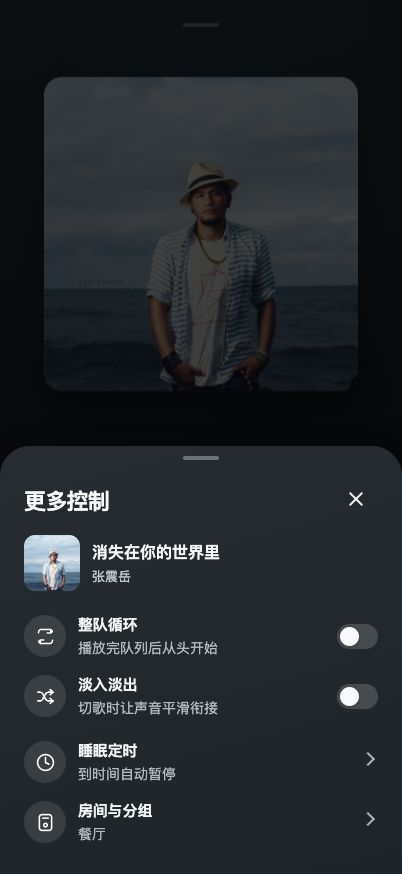

# Sonos QQ 音乐控制台

运行在 macOS 或 Linux 上的本地网页控制台，通过局域网控制 Sonos，并浏览 QQ 音乐歌单与全曲库。支持手机 Safari 和桌面浏览器，音频由 Sonos 播放。

## 界面预览

<p>
  
  
</p>

## 功能

| 分类 | 功能 |
| --- | --- |
| 音乐资料库 | “我喜欢”、自建与收藏歌单，多账号切换，歌单内搜索、全曲库搜索、本机最近播放 |
| 播放控制 | 播放与暂停、切歌、进度拖动、音量微调、静音、随机播放、单曲与整队循环 |
| 播放队列 | 歌单导入、队列点播、下一首播放、追加曲目、调整顺序与移除曲目 |
| 歌词与封面 | 封面配色渐变、逐行歌词、QQ 音乐提供的逐行翻译 |
| 房间与分组 | 自动发现 Sonos、切换控制房间、组合与拆分房间、分组音量 |
| 更多控制 | 淡入淡出、按分钟或指定时刻设置睡眠定时 |
| 加载体验 | 歌单缓存优先显示、后台更新、记住每个账号的上次歌单 |

## 快速开始

### 运行要求

- macOS 或 Linux，Node.js 20 及以上；Linux NAS 也可使用 Docker Compose。
- 服务与 Sonos 位于可互访的局域网，服务可访问 QQ 音乐。
- 在 Sonos App 中添加具有播放权限的 QQ 音乐账号，并播放一首 QQ 音乐歌曲，供服务识别音箱的账号参数。

### 本地运行

```sh
git clone https://github.com/knightyui/SonosWebControl.git
cd SonosWebControl/web
npm start
```

项目仅使用 Node.js 内置模块，无需安装第三方 npm 依赖。服务默认自动发现音箱，无需配置 `SONOS_IP`。

本机访问 `http://localhost:38473`；手机或其他电脑访问 `http://<服务器局域网地址>:38473`。首次打开后，从“QQ 账号”扫码登录，选择歌单并点击歌曲播放。

## 部署

### Linux / NAS：Docker Compose

在支持 Docker Compose 的 Linux 主机或 NAS 上，从仓库根目录执行：

```sh
git clone https://github.com/knightyui/SonosWebControl.git
cd SonosWebControl
docker compose up -d --build
docker compose ps
```

访问 `http://<NAS局域网地址>:38473`。Compose 使用 Linux 主机网络，支持局域网音箱发现；端口 `38473` 必须可用。登录会话与最近播放持久化在命名卷 `sonos-data` 中。

可选配置写入仓库根目录的 `.env`，例如：

```dotenv
PORT=38473
# 多播不可用时，可指定音箱的 IPv4 初始地址：
# SONOS_IP=192.168.0.100
```

更新代码并重建服务：

```sh
git pull --ff-only
docker compose up -d --build
```

仅重启服务或查看日志：

```sh
docker compose restart sonos-web
docker compose logs --tail=80 sonos-web
```

`docker compose down` 保留持久化数据；`docker compose down -v` 会删除卷中的登录会话与播放记录。

### Linux：直接运行 Node.js

在仓库的 `web/` 目录执行：

```sh
SONOS_DATA_DIR=/path/to/sonos-data npm start
```

将 `/path/to/sonos-data` 替换为可写的持久化目录。使用 systemd 或 NAS 任务管理器托管时，将工作目录设为仓库的 `web/`，启动命令设为 `node server.mjs`，并为进程配置 `SONOS_DATA_DIR`。同一端口只能运行一个服务实例。

### macOS：登录后自动运行

从仓库根目录复制启动模板：

```sh
mkdir -p ~/Library/LaunchAgents
cp deploy/com.sonos-web.plist.example ~/Library/LaunchAgents/com.sonos-web.plist
command -v node
pwd
```

编辑复制后的 plist，替换两个占位符：

| 占位符 | 替换内容 |
| --- | --- |
| `{{NODE_BIN}}` | `command -v node` 输出的绝对路径 |
| `{{PROJECT_DIR}}` | 仓库根目录的绝对路径 |

加载并启动服务：

```sh
launchctl bootstrap "gui/$(id -u)" "$HOME/Library/LaunchAgents/com.sonos-web.plist"
launchctl kickstart -k "gui/$(id -u)/com.sonos-web"
```

模板默认自动发现音箱。已安装旧服务时，先停用旧配置，避免多个实例占用同一端口。

## 使用说明

### QQ 账号与播放权限

网页 QQ 账号用于浏览歌单、搜索和补全歌曲资料；音箱使用 **Sonos App 中配置的 QQ 音乐账号** 获取音频。两个账号可以不同，但音箱账号必须具有目标歌曲的会员或版权权限。网页切换账号不会修改 Sonos 的登录状态。

在“QQ 账号”菜单中添加或切换网页登录账号。若 Sonos 添加了多个 QQ 账号，先在 Sonos App 中使用目标账号播放一首歌曲，再从网页点播。

扫码不可用时，可通过登录面板的备用入口导入 QQ 音乐网页 Cookie。该入口仅接受服务本机的 `localhost` 请求；远程部署可通过 SSH 本地端口转发访问。

### 歌单与播放队列

- 点击“当前歌单”切换歌单；歌单内搜索筛选当前列表，独立的“搜索”入口查询全曲库。
- 从歌单点播时，以该歌单替换 Sonos 队列：所选歌曲先播放，其余曲目在后台导入。正常导入不显示进度提示，失败时提示原因。
- 同一歌单再次点播已入队歌曲时直接切换，不重复导入；导入过程中选择未入队歌曲时优先播放新选择。
- 随机播放为网页歌单生成新的播放顺序；其他来源队列使用 Sonos 的随机模式。
- 曲目右侧“···”提供下一首播放或追加操作；播放队列支持点播、翻页、上移、下移和移除。列表过期时要求刷新，防止操作错误曲目。
- “最近播放”仅记录本网页成功发起的点播，每个网页账号最多保存 100 首，不同步 QQ 音乐 App 或 Sonos App 的历史。

手机上点击底部播放条进入完整播放页，向下滑动返回资料库。播放页可调整进度和音量、查看歌词，或打开播放队列及“更多控制”。

### 歌单缓存

同一浏览器、同一网页地址再次打开时，先显示上次歌单，再后台更新。缓存按 QQ 账号和歌单隔离；服务确认当前账号与歌单后才启用缓存曲目的点播。内容未变化时保留列表位置，后台更新失败时保留已有列表。

浏览器最多保存最近 3 份歌单快照，空间不足时舍弃旧快照或退回正常加载。首次访问、清除网站数据或更换访问地址后，需要重新加载。缓存不包含 Cookie 或音频，不提供离线播放。

服务端歌单缓存有效期为 30 分钟。QQ 音乐中的歌单发生变化后，可点击“刷新歌单”立即重新拉取。

### 音箱发现与房间控制

服务通过 IPv4 SSDP 发现 Sonos，再读取同一 Sonos 系统的房间拓扑。音箱 IP 变化或连接失效时自动重新发现；也可从“更多控制 → 房间与分组”点击“重新发现音箱”。房间选择按设备 ID 保存。

自动发现需要 UDP 1900 多播及响应单播可达，音箱控制需要 TCP 1400。VPN、VLAN、防火墙或容器桥接可能阻断发现；Linux Docker 应使用仓库提供的主机网络模式。多播不可用时，可设置 `SONOS_IP` 指定初始音箱地址。

“房间与分组”可切换控制房间、加入或移出分组，并调节分组音量。立体声配对和家庭影院的隐藏成员不单独列为房间；不同的独立 Sonos 系统不会合并显示。

### 睡眠定时与歌词

睡眠定时支持若干分钟后停止，或在浏览器本地时间的指定时刻停止；当日时刻已过时使用次日。定时保存在 Sonos 中，关闭网页后仍生效。

歌词支持原文与 QQ 音乐逐行翻译同步显示；歌曲没有可用译文时，仅显示原文。

## 配置

| 环境变量 | 默认值 | 说明 |
| --- | --- | --- |
| `SONOS_IP` | 空 | 自动发现；可选填音箱 IPv4 初始地址 |
| `PORT` | `38473` | 网页服务端口 |
| `HOST` | `0.0.0.0` | 监听地址；仅本机使用可设为 `127.0.0.1` |
| `SONOS_DATA_DIR` | `web/` | 登录会话与最近播放目录；Compose 使用 `/data` |

环境变量由启动进程提供；直接执行 `npm start` 不会自动读取 `.env`。Compose 从仓库根目录的 `.env` 读取其支持的配置项。

## 服务维护

### 重启 macOS 服务

重启前，确认歌单后台导入已结束，避免中断任务。`/api/queue/import` 返回的 `import` 为 `null` 或其 `phase` 为 `complete` 时，导入已结束。

以下命令适用于仓库模板；使用自定义配置时，调整 plist 路径：

```sh
plist_path="$HOME/Library/LaunchAgents/com.sonos-web.plist"
service_label=$(/usr/libexec/PlistBuddy -c 'Print :Label' "$plist_path")
launchctl kickstart -k "gui/$(id -u)/$service_label"
launchctl print "gui/$(id -u)/$service_label"
```

修改 plist 后，需重新加载配置：

```sh
launchctl bootout "gui/$(id -u)" "$plist_path"
launchctl bootstrap "gui/$(id -u)" "$plist_path"
```

模板日志位于 `web/.server.stdout.log` 和 `web/.server.stderr.log`。停用服务使用上述 `bootout` 命令。

前台运行的服务可在原终端按 `Control-C` 停止，再使用相同环境变量执行 `npm start`。Docker 的重启与更新命令见[部署](#部署)。所有部署方式均应等待后台导入结束后再更新或重启。

### 状态检查与数据备份

```sh
curl -fsS -o /dev/null -w '%{http_code}\n' http://localhost:38473/
curl -fsS http://localhost:38473/api/rooms
```

第一条返回 `200` 表示网页可用，第二条返回发现的房间列表。自定义端口时替换 `38473`。

备份 `SONOS_DATA_DIR` 或 Docker 的 `sonos-data` 卷可保留登录会话与最近播放。登录会话含 Cookie，应作为凭据妥善保存；浏览器歌单缓存与服务端数据分别存储。

## 开发与测试

```sh
cd web
npm test
```

测试覆盖队列切换与失败恢复、播放状态同步、过期曲目保护、搜索分页、歌单缓存及账号隔离、自动发现与 IP 恢复、多房间拓扑和页面语义。测试使用模拟设备与存储，不控制真实音箱。

主要目录：`web/public/` 为网页界面，`web/server.mjs` 为服务入口，`web/test/` 为回归测试，`deploy/` 为 macOS 启动模板，`compose.yaml` 为 Linux / NAS 容器配置。

## 使用限制

- 网页服务没有用户访问认证，仅适合可信局域网，不应直接暴露到公网。
- QQ 音乐网页接口并非公开 API，可能随服务变动而失效。
- 播放权限由 Sonos 中的 QQ 音乐账号决定；本项目不保存音频文件或 QQ 密码。
